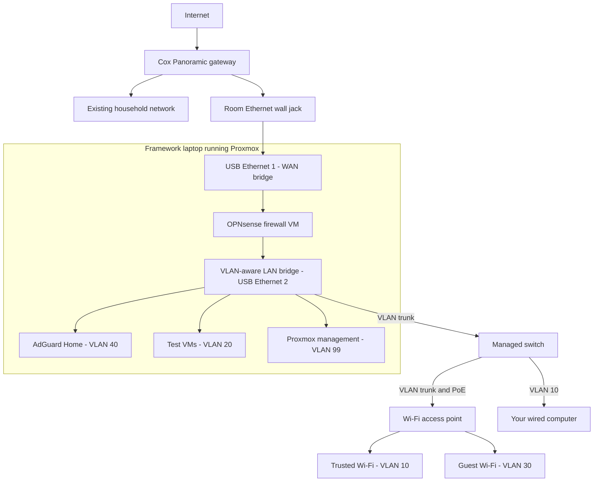

Goal: 
This is my first time attempting to create an indepentdent "enterprise" esq home network. The goal is to take one of my two links from my ISP, turn my old school laptop into a server hosting my virtual firewall, then passing this to a managed switch with the intent of having multiple functioning devices on the other side. I have many devices, smart surge protectors, intelligent thermostats for my bioactive snake enclosures, etc. that probably should not be touching my private network with as much freedom as they have been. That is my main motivation. Long term I plan to add some cloud implementation and network attatched storage for fun, I dont necessarily have a need for this at the present moment, I just want to experience the set up first hand.

Current Status:
10/7/26 - Setting up my first repository to track my progess and push updates. I have acquired two USB-C to ethernet adapters that fit within my budget to start allowing this virtual passthrough on my old laptop. The laptop itself is quite capable, it is a framework i5-1240P with 2x8 GB 3200 sodimms. The RAM will eventually be lacking, BUT, I will upgrade this when the intensity is required. 

Planned Network Architecture

Status: Planned — not yet deployed.

